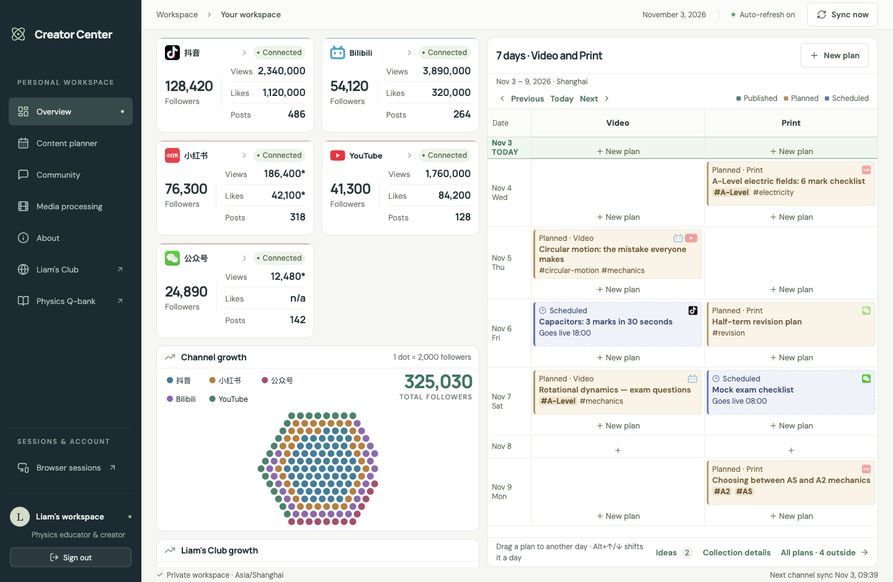
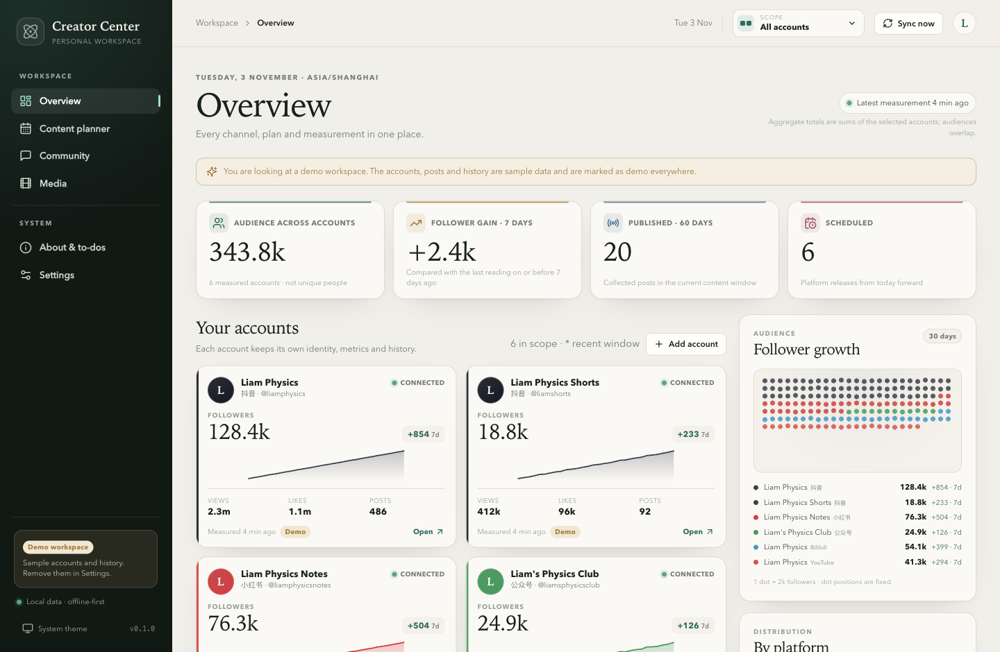

# Creator Center

A local-first workspace for one physics creator managing five channels: **抖音, 小红书, 公众号,
Bilibili and YouTube**. It keeps the account model, content planner, publishing timeline,
analytics and community monitor in one standalone application instead of a LAN dashboard with
Docker, a separate browser host and a watchdog.

> **Status: live collection started.** The desktop shell, local API, SQLite workspace,
> per-account model, redesigned overview, detailed account view, content planner, timeline,
> cross-post merges, Community monitor, About/to-dos and the old-workspace import are
> implemented. The embedded per-account sessions and the first live collector (抖音) are in.
> The remaining browser collectors, YouTube OAuth, media processing, cover rendering and
> installers are the next increments. The boundaries are listed under
> [What remains](#what-remains) and in [docs/IMPLEMENTATION.md](docs/IMPLEMENTATION.md).

## Before and after

The old app is the baseline; the new app is a standalone redesign with multiple accounts per
platform, a cleaner dashboard and a detailed per-account view. Both captures use a 1440 × 940
viewport, the light theme and a local fixture/demo workspace.

| Before — old LAN dashboard | After — Creator Center |
| --- | --- |
|  |  |

The old capture is the real `creator-center-old` frontend served with a local fixture API; the
new capture is the desktop renderer against the demo SQLite workspace. The rest of the evidence
set is in [docs/screenshots](docs/screenshots).

## What works

- **One account, one ID.** Multiple accounts on the same platform coexist with separate metrics,
  posts and history. The overview labels every account, and the scope switcher filters all
  numbers to all accounts, one platform or one account.
- **Cleaner overview.** A KPI band, account cards, a follower dot pool with seven-day gains,
  platform distribution, Community growth and a publishing timeline.
- **Detailed account view.** Identity, session/analytics/content state, a compact metric view
  (followers, posts, likes, comments, shares) that expands to every metric with its scope,
  availability, period, source and reason, follower history, published and scheduled content,
  plans targeting the account, and account actions.
- **Content planner.** Five content types, default channels and formats, optional date, notes
  hashtags, exam tag aliases, tag catalogue, platform/all-account or specific-account targets,
  publication links, unsaved-change protection and delete confirmation.
- **Timeline.** Fifteen-day calendar in Asia/Shanghai with Video and Print lanes, distinct plan,
  published, scheduled and merged cards, per-account metrics, drag/keyboard rescheduling, plan
  publication links, 2–5 post merges (one per account), unmerge, undated ideas and a full plan
  list.
- **Community monitor.** A configurable Discourse status endpoint, cached last-good snapshot,
  connectivity/authentication/latency, all-time/24-hour/7-day catalogue counts, worker and timer
  health, mention/graph/PDF status and 30-day growth history.
- **Local operations.** SQLite with versioned migrations, a documented data directory, local
  server bound to `127.0.0.1`, background sync, window-state restoration, single-instance lock,
  English UI, light/dark/system theme, a Text size setting with a live preview, About/to-dos and
  changelog.
- **Demo workspace.** Six sample accounts (including two on 抖音), thirty days of history,
  realistic plans, posts, three account-keyed merges, scheduled releases and community snapshots.
  It is clearly marked and removable in Settings.
- **Old-workspace import.** An opt-in Settings workflow and CLI migrate the old app's accounts,
  metrics, history, posts, plans, tags, merges, to-dos and Community history. Preview first,
  require an empty workspace, and create a timestamped database backup automatically.
- **Live 抖音 collection (first platform).** Sign in from an account; each account gets an
  isolated persistent browser session. The sidecar asks the desktop collector bridge for a
  read-only creator-console snapshot (profile, metrics, published and scheduled posts,
  follower history) and writes it through the normal atomic sync. Other platforms stay
  truthfully login-required or setup-required until their collectors land.

## Run it

Prerequisites: Node.js 22.12 or newer (tested on Node 24), npm, and a Chromium-based browser for
the web development view. FFmpeg and platform accounts are not needed for the workspace itself.

```sh
npm install

# Optional: seed a demo workspace in .data/demo
npm run seed:demo -- --data-dir .data/demo

# API on 127.0.0.1:4317 + Vite on http://127.0.0.1:4318
npm run dev:demo
```

`npm run dev` uses `.data/dev` and starts with an empty workspace; `npm run dev:demo` uses the
seeded `.data/demo`. The app also opens empty until you add an account or choose **Explore the
demo workspace** from the empty state. Each platform collector is a later increment, so a real
account starts in `setup_required`; the demo workspace exercises every implemented workflow.

### Desktop shell

```sh
npm run build
npm run start:desktop:demo
```

The Electron main process starts the local API as a **Node sidecar** on an ephemeral loopback
port, waits for `/api/health`, and loads the built renderer. This keeps SQLite native code out of
the Electron ABI and gives the next packaging increment a single backend contract. The launcher
removes `ELECTRON_RUN_AS_NODE` when it is inherited from an automation environment.

## Migrating the old workspace

The importer reads the old app's SQLite database directly and never modifies it.

```sh
# Inspect first; writes nothing
npm run import:old -- --source ~/downloads/fieldnotes-20261103.sqlite3 --data-dir ~/.creator-center --dry-run

# Import into an empty workspace
npm run import:old -- --source ~/downloads/fieldnotes-20261103.sqlite3 --data-dir ~/.creator-center
```

In the app, open **Settings → Import the old workspace**, choose or paste the database path, press
**Preview**, then **Import workspace**. The destination must have no accounts (remove the demo
workspace first). A timestamped backup is written to `<data-directory>/backups/` before the
transaction starts.

Accounts keep one stable `legacy-<platform>` row per old platform (the old app had one account per
platform); metrics, history, content, plan targets/publication links, merges and to-dos are mapped
into the account-keyed model. Community history comes across as daily snapshots. Media project
metadata is preserved in a `legacy_media_jobs` staging table for the media increment, but media
files are not yet relinked.

Old browser sessions, YouTube OAuth tokens and dashboard passwords are **not imported**; reconnect
each account after migration. The importer requires the old database to have the expected tables
and refuses a non-empty destination.

## Live collection

Open an account and choose **Sign in**. The login window uses a persistent Electron session
partition per account; cookies stay in the desktop app. The sidecar asks the desktop collector
bridge for a read-only snapshot, then the existing atomic sync writes it. The bridge is
loopback-only and never exposes cookies.

抖音 is the first collector: profile and lifetime totals from the creator home, published and
timed work lists from the content manager, and the overview analytics. A signed-out or failed
collection keeps the last good reading and reports login-required, stale or error truthfully.
The remaining browser collectors and YouTube OAuth are the next stage.

## Tests and checks

```sh
npm test          # 58 domain/API/database tests
npm run typecheck # shared, server, web and desktop, with unused-code checks
npm run build     # shared + server + web + desktop
```

The tests cover tag normalisation and exam aliases, plan defaults/validation, target resolution,
timeline placement/lanes/merges, merge validation, SQLite migrations, account isolation, plan
publication links, dashboard scoping, to-dos, demo seeding/removal and API validation errors.

## Project layout

```
packages/shared   Domain types, platform capabilities, time, metrics, tags,
                  planning, merges and the pure timeline model.
apps/server       Local Express API, SQLite schema/migrations, repositories,
                  sync coordinator, platform-adapter contract, demo seed.
apps/web          React 19 + Vite renderer, design tokens and all workspace views.
apps/desktop      Electron shell, window state, single-instance lock, sidecar
                  lifecycle and preload bridge.
docs              Architecture/requirements mapping and visual evidence.
```

## What remains

These are deliberate next increments, not hidden gaps:

1. **Live collection.** 抖音 is implemented with embedded isolated sessions. The 小红书, 公众号
   and Bilibili collectors and the official YouTube Data + Analytics OAuth with per-channel
   grants remain.
2. **Media pipeline.** Local FFmpeg inbox watching, full-MP4 conversion, chapter/exclusion
   planning, two-screen alignment/join, clip previews/downloads, archive/link recovery and the
   optional Unraid worker/NFS endpoint. The settings page already stores its paths.
3. **Covers.** Deterministic HTML/CSS cover sets in all four ratios with BPhO, Cambridge, AP and
   Edexcel presets, reservation and seven-day cleanup.
4. **Migration and release.** Import of the old SQLite/media workspace, backup/restore,
   installers, signing/notarization and update path.
5. **Real connectors only where policy allows.** No publishing, liking or commenting in v1; no
   hidden automation and no CAPTCHA bypass.

## Security and privacy

The core workspace is local: no cloud account, telemetry or hosted backend. The API listens on
the loopback interface only, metrics/posts/history live in a local SQLite file, and the current
increment stores no platform cookies, tokens or passwords. Demo data is sample data. When
sessions and OAuth arrive, their material will use the OS keychain/encrypted storage and stay out
of logs, exports and diagnostics, as required by SEC-01/02.

## Design notes

The palette is warm paper and ink with a deep teal accent, a book serif for display text and a
system sans for data. Metrics keep their `scope` and `availability` visible: `value`, `pending`
and `unsupported` are different states, and a `*` on an account card marks a recent window rather
than a lifetime total. Dark mode uses chart-specific colour tokens so the 抖音 line remains
legible on a dark surface.

## Reference

- [REQUIREMENTS.md](REQUIREMENTS.md) — product requirements, decisions and open questions.
- [docs/IMPLEMENTATION.md](docs/IMPLEMENTATION.md) — requirement-by-requirement status,
  architecture and data model.
- [docs/screenshots](docs/screenshots) — before/after, text-size, macOS spacing and workflow evidence.
