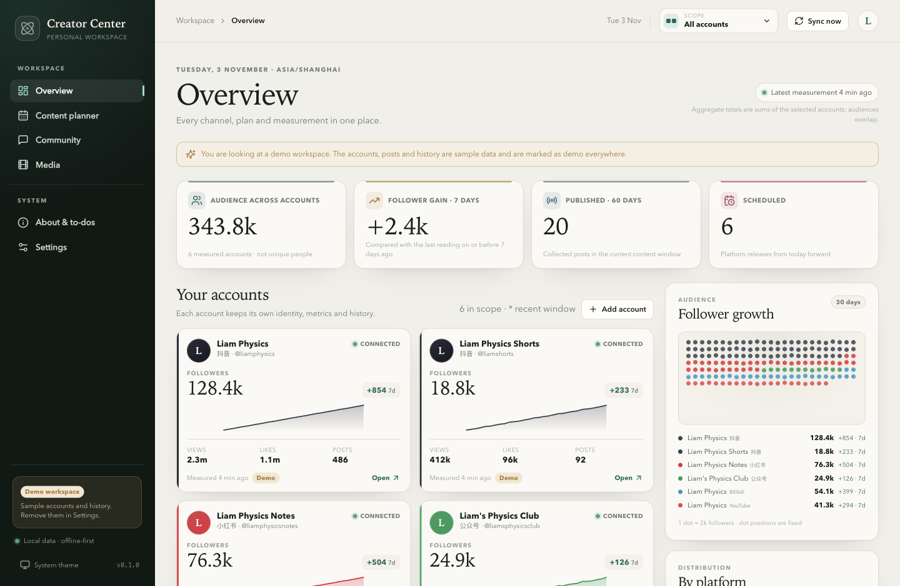
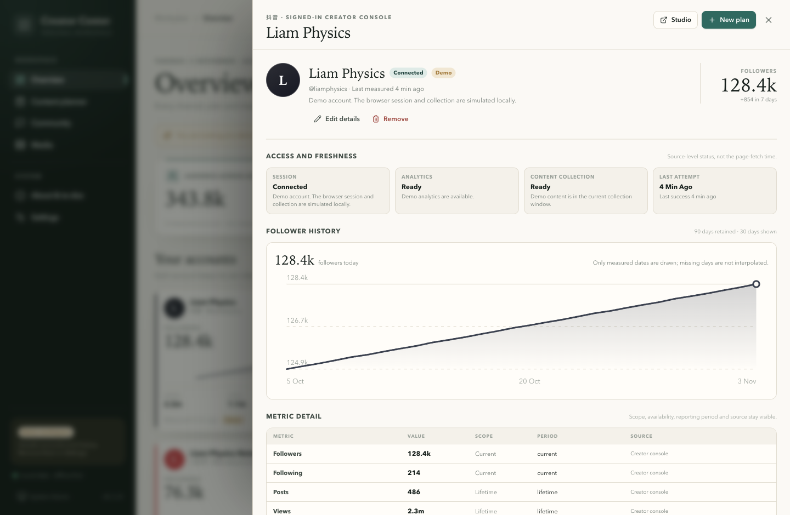

# Visual evidence

All browser captures use a **1440 × 940** CSS viewport unless noted. The before/after pairs use the
**light** theme and the same overview/account scenario. The after captures use the opt-in demo
workspace, so no private Feishu or platform account material is exposed.

## UI review follow-up (v0.1.1)

| Before (v0.1.0, merged) | After (v0.1.1) |
| --- | --- |
|  |  |
|  |  |

- [after-settings.png](after-settings.png) — Appearance with the new Text size control and its live
  preview at the selected scale.
- [after-overview-large.png](after-overview-large.png) — the same overview at the Large (130%) text
  setting; the 1200 px layout has no horizontal overflow.
- [after-settings-large.png](after-settings-large.png) — the settings preview at 130%.
- [after-account-metrics-expanded.png](after-account-metrics-expanded.png) — the `Show all metrics`
  state with all 11 metrics.
- [after-macos-desktop.png](after-macos-desktop.png) — actual Electron renderer on macOS. The native
  traffic lights are not included by `webContents.capturePage`, so the reserved 46 px strip above
  the brand is visible but empty. Measured in that window: sidebar padding-top 58 px, brand y=58,
  drag strip y=0–46, top bar x=248. This is the room the native controls now sit in.

The Text size control scales every label, table and card (0.9–1.4 multiplier; the UI offers
Compact 100%, Comfortable 112% and Large 130%). The preview uses the same scale. The metric detail
opens collapsed to followers, posts, likes, comments and shares, and expands to all 11 metrics.

## Original first increment

| File | What it shows |
| --- | --- |
| [before-old-overview.png](before-old-overview.png) | Baseline: the real `creator-center-old` frontend, served by a local fixture API, with the old 5-channel card layout, dot pool and side timeline. |
| [after-overview.png](after-overview.png) | After: redesigned overview with KPI band, per-account cards, follower dot pool and platform distribution. |
| [after-timeline.png](after-timeline.png) | The same overview scrolled to the 15-day Video/Print publishing timeline. |
| [after-overview-full.png](after-overview-full.png) | Full-height overview including Community growth, timeline and footer. |
| [after-overview-dark.png](after-overview-dark.png) | Overview in dark mode, including chart-specific colour tokens. |
| [after-account-detail.png](after-account-detail.png) | Detailed per-account drawer with collapsed metric essentials. |
| [after-planner.png](after-planner.png) | Content planner list, filters, tag catalogue and status legend. |
| [after-plan-dialog.png](after-plan-dialog.png) | Plan editor with content defaults, account targets, tags and publication links. |
| [after-merge-dialog.png](after-merge-dialog.png) | Account-keyed merge editor with one post per account. |
| [after-community.png](after-community.png) | Community monitor: status, catalogue counts, growth and worker health. |
| [after-settings.png](after-settings.png) | Local data, Text size, Community endpoint, sync, media paths, accounts and demo controls. |
| [after-about.png](after-about.png) | About, to-dos, changelog, roadmap and data directory. |
| [after-onboarding.png](after-onboarding.png) | Empty-workspace onboarding. |
| [after-add-account.png](after-add-account.png) | Add-account dialog. |
| [after-first-account.png](after-first-account.png) | A real account in `setup_required` state. |

## Capture method

- New app: Vite renderer against the demo API; screenshots taken with a Chromium browser at
  1440×940. The macOS capture is the actual Electron renderer at 1440×940 via the DevTools protocol.
- Old app: the actual `creator-center-old/frontend` production build served by a local mock API
  that returns the old dashboard/planner shape. This is a real application capture, not a mockup;
  the fixture data is labelled in the PR and implementation notes.
- The old screenshot includes the old app's five platform cards; the new app shows six accounts
  because it demonstrates multiple accounts on 抖音 (D1).
